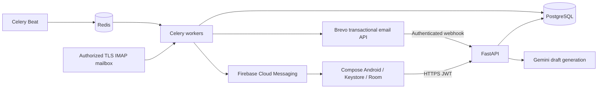

# Architecture and invariants

This is a single-organization deployment with administrator and operator accounts.
It is not a multi-tenant SaaS. All authenticated organization users share contacts and campaigns.
Provision accounts using the server CLI; there is no public signup.

## Sending transaction protocol

1. Acquire the singleton settings row with PostgreSQL FOR UPDATE. Every quota, approval, suppression, pause, cancellation and outbound worker mutation follows the same lock order.
2. Check current campaign approval digest, state, sending window, organization stop flag, consent and recipient preferences/reply state.
3. Check the Redis per-minute request counter. If unavailable, fail closed.
4. Increment the organization and campaign local-date quota reservations under the lock. The lower organization/provider configured cap applies.
5. Commit message state `sending` before calling the provider. Redelivered Celery tasks cannot claim it again.
6. Reacquire the global lock; recheck recipient and campaign state. Hold this lock during the provider call to serialize unsubscribe/stop with in-flight sends.
7. Commit provider message ID and acceptance event. Create the next approved follow-up only after acceptance.

This deliberately serializes outbound requests per organization. At 300/day it favors reliable accounting over throughput.
An unsubscribe cannot retract a request already accepted or in flight; once the unsubscribe transaction completes, future tasks fail eligibility.

There is no general exactly-once guarantee across PostgreSQL and an external provider.
Brevo's limited idempotency window is extra protection, not the durable source of truth.
Network errors, 5xx, process death or a missing provider message ID enter `uncertain` and pause.
No automatic resend occurs for ambiguous acceptance. An administrator reconciles exact IDs using Brevo logs.
429 (known rejection) retries exponentially up to five attempts. Other known rejections pause for review.

## Quotas

Reservations include tests, retries, uncertain requests and requests cancelled after reservation. They never decrement automatically.
This may send fewer emails than the target but cannot exceed the configured ledger limit.
Set provider limits below the account's actual allowed capacity and reserve capacity for traffic sent by other systems.
The provider itself remains authoritative: 429 and credential/account errors are respected.
This service cannot account for email sent independently from other applications sharing the provider account.
Use a dedicated sender account and keep operational quota settings accurate.

Changing sending timezone after scheduling or ledger use is rejected. This prevents a timezone change from creating an extra sending day.
Per-minute counters count attempts conservatively and need Redis persistence. PostgreSQL ledger is authoritative for daily limits.

## Data model

Users and encrypted organization settings; customers and permanent keyed-hash suppressions; campaigns and frozen recipient snapshots; one message per recipient/sequence; per-day organization/campaign reservations; deduplicated provider events; audit log, devices, notification outbox and mailbox/AI counters.

Message status is the local dispatch state. Delivery, bounce, complaint and reply observations are separate deduplicated events, so late/out-of-order webhooks cannot erase an earlier delivery.
Campaign completion means the scheduled queue is exhausted, not that every accepted email was delivered.
Reply metrics exist only when the optional mailbox integration observes matching In-Reply-To/References and the sender address matches the campaign recipient.

## Secret boundaries

Gemini and Brevo keys are accepted over authenticated HTTPS settings APIs, Fernet-encrypted in PostgreSQL and never returned by GET.
The encryption key, JWT key, webhook token, unsubscribe HMAC key and optional mailbox password are server environment/secret-manager values.
Android stores only the session token encrypted with a nonexportable Keystore AES-GCM key. Room caches stay in app-private storage; backup is disabled and logout/session expiry clears caches.
API error bodies are sanitized for provider operations. Avoid enabling HTTP body logging.
